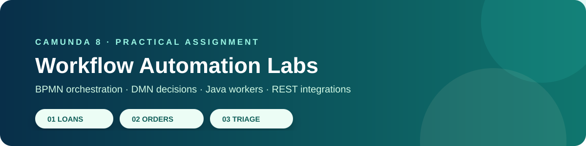
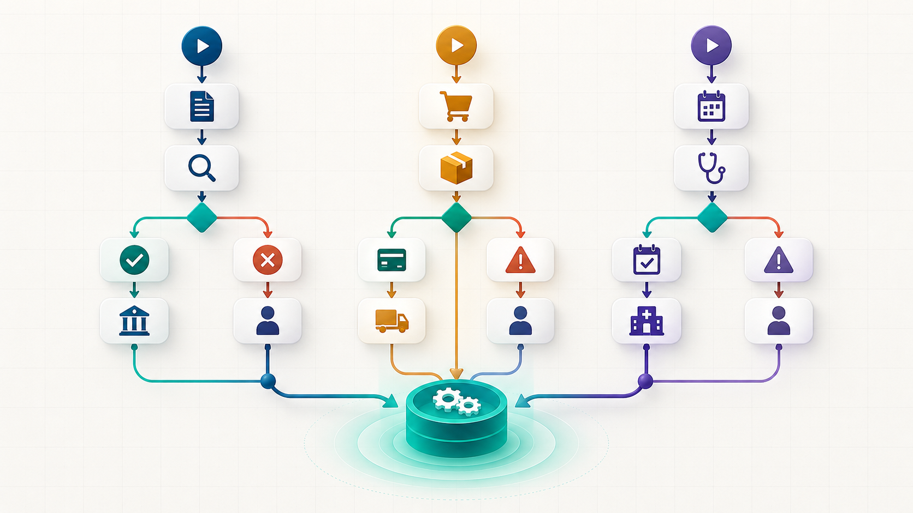

<div align="center">




**End-to-end workflow automation for loan approval, e-commerce fulfilment, and appointment triage.**

</div>

---

## What’s inside

This submission implements all three practical-assignment labs using a consistent Camunda 8 architecture. Each lab combines BPMN orchestration, DMN tables that calculate outcomes from each instance's variables, and Camunda REST Connector tasks for input validation and mock external services. The Spring Boot application hosts those local APIs; Tasklist handles human reviews and Operate supports incident recovery.

| Lab | Scenario | BPMN | DMN inputs → calculated result | Human task |
|:--:|:--|:--|:--|:--|
| 01 | Loan approval | [Open model](src/main/resources/models/lab-1-loan-approval.bpmn) | Income + amount + credit score → `loanDecision` | Loan review |
| 02 | E-commerce fulfilment | [Open model](src/main/resources/models/lab-2-order-fulfilment.bpmn) | Calculated order total + category + preference → `deliveryPriority` | Order verification |
| 03 | Hospital appointment & triage | [Open model](src/main/resources/models/lab-3-patient-triage.bpmn) | Urgency indicator + symptoms input → `triageCategory` | Clinical / scheduling review |

> **Decision behavior:** each BPMN business-rule task evaluates its matching DMN table with the current process variables. The outgoing BPMN gateway routes on the DMN result; there is no fixed start-time decision or REST decision endpoint.

> **Data safety:** all examples are synthetic. This repository contains no real payment details, credentials, patient data, or personal information.

## Architecture at a glance

```text
Process input ──► BPMN orchestration ──► REST validation API
                         │                       │
                         ▼                       ▼
                  DMN decision table       process variables
                         │                       │
                         └──► BPMN gateways ◄────┘
                                  │
                   REST integration APIs / Tasklist
                                  │
                              Operate
```

<p align="center">
  
  <br />
  <sub><i>DMN tables calculate decisions from process inputs; REST Connector tasks validate inputs and call the synthetic integration APIs.</i></sub>
</p>

## Repository map

```text
BPMN_Exercise_4/
├── src/main/resources/models/      # Three BPMN models and three input-based DMN tables
├── src/main/java/                  # Spring Boot app and validation/integration APIs
├── docs/                           # API guide, variables, report, test matrix
├── evidence/                       # Add your own Tasklist / Operate screenshots here
├── assets/                         # README visual assets
├── pom.xml
└── README.md
```

## Quick start

### 1. Prerequisites

- Java 21
- [Camunda 8 Run 8.8](https://downloads.camunda.cloud/release/camunda/c8run/8.8/) already unzipped
- Maven 3.9+; the installed copy on this machine is `C:\Users\ditod\Downloads\apache-maven-3.10.0`

### 2. Start Camunda, then the REST API application

Terminal 1, in PowerShell:

```powershell
Set-Location "$HOME\Downloads\camunda8-run-8.8-windows-x86_64\c8run-8.8.32"
.\c8run.exe start
```

- Operate: http://localhost:8080/operate
- Tasklist: http://localhost:8080/tasklist
- Login: `demo` / `demo`

Terminal 2, in PowerShell:

```powershell
Set-Location "$HOME\OneDrive\Desktop\dataset\BPMN_Exercise_4"
& "$HOME\Downloads\apache-maven-3.10.0\bin\mvn.cmd" spring-boot:run
```

The application deploys the BPMN and DMN models and exposes the synthetic APIs at `http://localhost:8081/mock/*`. Leave both terminals open during the demo.

### 3. Run the three labs

Create each process instance with the PowerShell commands in the [Test Matrix](docs/TEST_MATRIX.md). Use Operate to monitor instances and recover incidents; use Tasklist to complete the human review tasks assigned to `demo`. Incident recovery steps are in the [REST Connector Guide](docs/REST_CONNECTOR_GUIDE.md).

## Lab snapshots

<details open>
<summary><b>01 · Loan approval</b></summary>

`Validate applicant (REST) → credit assessment (REST) → loan DMN → approve / reject / manual review`

The loan DMN compares submitted income and amount with the score returned by the mock credit API. Invalid applications close early; borderline applications create a Tasklist review.
</details>

<details>
<summary><b>02 · E-commerce fulfilment</b></summary>

`Validate order, calculate total, and check stock (REST) → order-priority DMN → payment (REST) → fulfilment / verification`

Orders with unavailable stock or declined payment end cleanly. High-value orders route through an explicit manual-verification task.
</details>

<details>
<summary><b>03 · Hospital appointment & triage</b></summary>

`Validate registration (REST) → triage DMN → scheduling (REST) → available / staff review`

`RED` cases go immediately to clinical assessment. No available slot creates a scheduling-review task. This is an educational workflow only—not medical advice or clinical decision support.
</details>

## Documentation

- [Implementation report](docs/IMPLEMENTATION_REPORT.md) — architecture, results approach, assumptions, and limits
- [Variable dictionary](docs/VARIABLE_DICTIONARY.md) — variable names, types, and purpose
- [REST connector guide](docs/REST_CONNECTOR_GUIDE.md) — connector configuration and request/response examples
- [Test matrix](docs/TEST_MATRIX.md) — required normal, exception, and recovery scenarios
- [Evidence and screenshots](evidence/README.md) — genuine Operate screenshots for all three labs and remaining evidence checklist
- [Presentation guide](docs/PRESENTATION_GUIDE.md) — sample inputs, DMN rules, REST connector settings, and where to show them

## Incident recovery demo

To demonstrate an incident, switch the relevant mock service off before starting the process, then switch it back on after the incident appears in Operate. Retry the failed job:

```text
Switch mock off → run instance → Operate incident → switch mock on → retry job → complete instance
```

The credit, payment, and scheduling integration connectors are configured with one attempt so the incident appears quickly. Retry repeats the HTTP request with the same process variables, so use the mock controls rather than changing `simulateFailure` on the failed instance. Record the incident and successful retry in the test matrix. The [evidence folder](evidence/README.md) contains genuine Operate screenshots from an earlier deployment; capture fresh screenshots for this updated deployment.

## Repository description

> Camunda 8 workflow automation labs for loan approval, e-commerce order fulfilment, and appointment triage, with input-driven DMN decisions, Spring Boot REST APIs, Camunda REST Connector tasks, Tasklist review, and incident recovery.

## Technology note

The project uses the official Camunda Spring Boot Starter to deploy the BPMN/DMN resources and host the synthetic REST APIs. Refer to the [Camunda Spring Boot Starter documentation](https://docs.camunda.io/docs/apis-tools/camunda-spring-boot-starter/getting-started/) for runtime and connection options.
